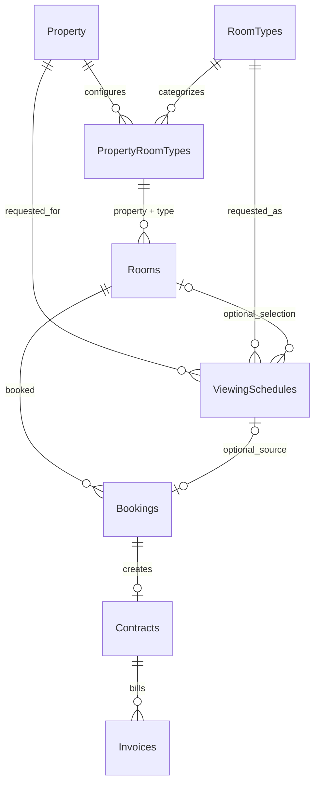

# Property-scoped room types, rent and viewing-to-book rollout

## Rollout status

The application refactor and an idempotent migration script are prepared locally. **The Live database has not been changed.** Do not deploy the new backend against the old schema or apply this migration until a PostgreSQL 17 rehearsal, verified backup/restore rehearsal, and the required Live approval are complete.

## Data flow

`PropertyRoomTypes` owns the rent and active flag for each property/type pair. A customer requests a viewing for a property and type; a manager later selects a physical room. Booking stores `AgreedMonthlyRent` when accepted. Contract creation reads that snapshot, and rent invoices continue to use the Contract rent.

## Implemented surfaces

- Backend domain/model, scoped configuration service/controller, public listing projection, viewing authorization/assignment, room availability, Booking rent snapshot, Contract creation, and EF migration.
- Admin API: `GET/POST /api/properties/{propertyId}/room-types`, `PUT /api/properties/{propertyId}/room-types/{roomTypeId}`, and `PATCH /api/properties/{propertyId}/room-types/{roomTypeId}/status`.
- Public API: `GET /api/public/properties/{propertyId}/room-types`.
- Viewing API: customer creates a request with `PropertyId` + `RoomTypeId`; a manager lists candidates at `GET /api/viewing-schedules/{id}/available-rooms` and assigns one with `PUT /api/viewing-schedules/{id}/selected-room`.
- Frontend adds property-level rent management and grouped public prices, updates the viewing request/manager selection flow, and adds the selected viewing-to-Booking action. Direct Booking from a physical room remains supported.
- `RoomTypes.Price` remains in the legacy schema, but property/public pricing paths use the scoped configuration.

## Migration and data preflight

Migration: `PRN232_BE/PRN232.Infrastructure/Migrations/20261114085610_PropertyScopedRoomTypesAndViewingFlow.cs`.

It creates the property/type configuration and composite room relationship; backfills distinct existing property/type pairs; copies old prices without normalizing them; marks configurations inactive when the old price is below 10,000; fills existing viewings' property/type from their room; makes viewing property/type required and physical RoomId optional; and adds Booking rent snapshot plus optional ViewingId. It aborts if an existing viewing cannot be reconciled. The new table has RLS enabled and no client policies; access is granted only to the backend service role.

Read-only Live baseline for project `qvdrjyecaprfpgvbfyfe`: 32 properties, 12 room types, 421 rooms, 9 viewings, 25 bookings, 6 contracts, and 121 distinct property/type pairs. The new configuration table is not present and the latest recorded migration is `20261113155533_AddGoogleSignIn`.

One legacy global price is anomalous: RoomType 1 has price 3,000. It is preserved as historical input and its migrated configuration is inactive; the migration does not guess a corrected price. Booking 4 (RoomId 8) has deposit 1,000 while Contract 2 for the same room has rent 2,000,000. That discrepancy is unresolved, so the historical Booking snapshot remains null and Contract creation refuses it until a human reconciles the accepted rent.

The generated idempotent SQL is `PRN232_BE/PRN232.Infrastructure/Migrations/20261114085610_PropertyScopedRoomTypesAndViewingFlow.sql` (9,499 bytes, SHA-256 `A6AB768F3703AE7A8589325BB366E9721FFC859F5125918A73507474D99C4BF2`).

## Cutover and recovery

This is a schema cutover, not a zero-downtime deployment with the old backend: the old version does not populate the new configuration or viewing fields. Use a controlled maintenance window or prepare a separately reviewed compatibility release. `Down()` is intentionally unsupported because dropping the snapshot/configuration could lose accepted business data. Recovery after writes requires a verified restore or a reviewed forward-fix.

The Live migration remains gated. No approved backup identifier or restore rehearsal is available in this workspace. The isolated PostgreSQL test connection is unset, and Docker's Linux daemon is unavailable, so PostgreSQL 17 migration/concurrency rehearsal could not run. Keep the Live database unchanged until those gates and approval are satisfied.

## Verification

- Frontend production build (`npm run build`): passed.
- Frontend full suite (`npm test`): 51 test files / 386 Vitest tests passed; Node contract tests 2/2 passed.
- Backend API build (`dotnet build ... --no-restore`): passed with 0 warnings and 0 errors.
- Targeted backend contract/rent and authorization tests: 11 passed after updating modern Booking fixtures with their rent snapshot.
- EF model check: `dotnet ef migrations has-pending-model-changes` reports no pending model changes.
- Backend full suite excluding `SupabaseReadOnlyInspectionTests` (which requires the owner-approved backup gate): 1,511 passed, 24 skipped, 0 failed. The PostgreSQL-only cases were skipped because the isolated PostgreSQL 17 environment is unavailable.
- Live preflight was read-only. No migration, seed, or business-data write was issued.

## Worktree note

The workspace already contained geocoding/location and equipment-page edits. Those larger changes were preserved; a small adjacent geocoding signature alignment was needed for the API build. They are outside this refactor's rollout scope.
